# RHEL 10 — User Management, Permissions, ACLs & Restricted Sudo

> **Lab 02** · Independent system administration practice · Red Hat Enterprise Linux 10

## Overview

This hands-on lab simulated preparing a Linux server for two teams, **Infrastructure** and **Helpdesk**. The work covered account provisioning, password policies, shared directory access, POSIX permissions, access control lists (ACLs), restricted sudo, and permission troubleshooting. Configuration was tested with multiple user accounts, followed by checks after a reboot.

**Scope:** Personal lab environment, not a production deployment. The steps below document what was configured and tested, including mistakes and corrections. Some access-inheritance behavior was only partially tested and is noted explicitly.

## Lab objectives

- Create three users with defined UIDs, primary groups and supplementary memberships.
- Apply individual password aging and account expiration policies.
- Secure departmental directories while supporting group collaboration.
- Configure access ACLs and default ACL inheritance on a shared project directory.
- Allow a helpdesk user to restart `sshd` with a restricted passwordless sudo rule.
- Set user-specific file creation defaults with `umask`.
- Reproduce and resolve a restrictive ACL mask problem.
- Verify system configuration after reboot.

## 1. User and group administration

The lab accounts were:

| User | UID | Primary group | Supplementary group |
|---|---:|---|---|
| `john` | 2100 | `john` | `infrastructure` |
| `davis` | 2200 | `davis` | `infrastructure` |
| `harry` | 2300 | `harry` | `helpdesk` |

I created the `infrastructure` and `helpdesk` groups and used `useradd`, followed by `passwd`, to provision the accounts. For example:

```bash
groupadd infrastructure
groupadd helpdesk
useradd -u 2100 -G infrastructure -d /home/john -s /bin/bash john
passwd john
```

I configured the other accounts using their specified UIDs and group memberships, then tested interactive logins and checked group membership.

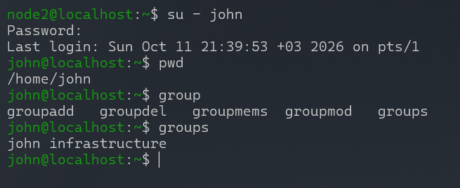

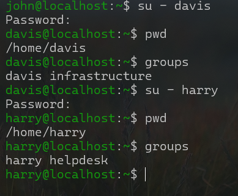

## 2. Password aging and account expiration

The individual policies were:

| User | Maximum age | Minimum age | Warning days |
|---|---:|---:|---:|
| `john` | 60 | 7 | 10 |
| `davis` | 30 | 5 | 7 |
| `harry` | 90 | 0 | 14 |

I used `passwd` options `-x`, `-n`, and `-w` to configure these values. For Davis, `passwd -e` was used to force a password change at the next login.

```bash
passwd -x 60 -n 7 -w 10 john
passwd -x 30 -n 5 -w 7 -e davis
passwd -x 90 -n 0 -w 14 harry
passwd -S john
chage -l harry
```

**Correction made during the lab:** I originally confused the *last password change date* (`chage -d`) with *account expiration* (`chage -E`). After correcting the option, `chage -l harry` displayed an unexpected one-day difference between the entered date and displayed expiration date. Entering `2027-01-01` produced a displayed expiration of **December 31, 2026** in this VM. The underlying reason for the discrepancy was **not established**, so that input should **not** be treated as a general solution or recommended command for other systems. The stored date and timezone behavior would need further investigation.

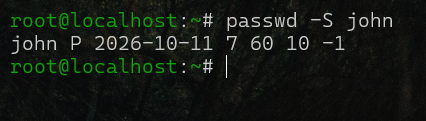

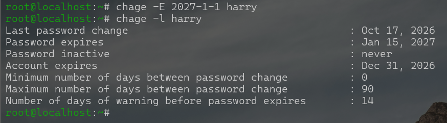

## 3. Departmental shared directories

I created:

```text
/company/
├── infrastructure/
├── helpdesk/
└── projects/
```

### Infrastructure directory

Access was granted to `john` and `davis` through named ACL entries, while `harry` and unrelated users were restricted. I assigned the group `infrastructure` and set the **setgid** bit so newly created entries would inherit the parent directory's group.

Representative commands from my configuration:

```bash
setfacl -m u:john:rwx /company/infrastructure
setfacl -m u:davis:rwx /company/infrastructure
setfacl -m u:harry:--- /company/infrastructure
chown -hR root:infrastructure /company/infrastructure
chmod g+s /company/infrastructure
setfacl -m o:--- /company/infrastructure
```

**Troubleshooting:** Changing ownership with `chown` did not by itself cause new entries to inherit the group. I consulted the manual pages and discovered that the directory's **setgid** bit was needed. I verified inheritance by creating a file and directory as John.

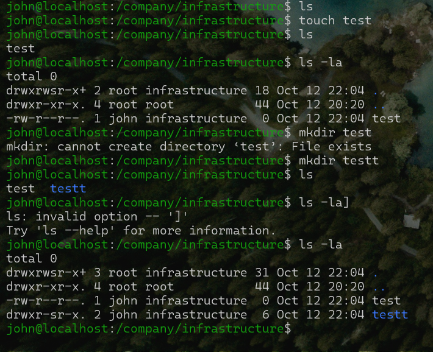

### Helpdesk directory

I configured `/company/helpdesk` for helpdesk members, with read/traverse access for the `infrastructure` group and no access for unrelated users. After testing, I corrected the infrastructure group ACL from `r--` to `r-x` because directory traversal requires the execute (`x`) permission.

```bash
chown root:helpdesk /company/helpdesk
chmod g+s /company/helpdesk
setfacl -m g:infrastructure:r-x /company/helpdesk
setfacl -m o:--- /company/helpdesk
```

I also adjusted group access for `helpdesk`, tested creation as Harry, and tested denied access as an unrelated user. **Limitation:** The supplied record does not conclusively verify that *all descendants created later* inherit the complete intended helpdesk ACL policy. Group ownership inheritance from setgid and permissions inheritance from default ACLs are different things.

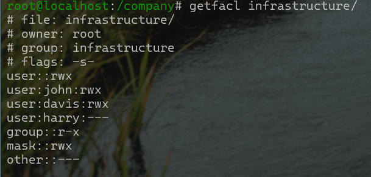

## 4. Project directory ACLs and inheritance

I created `/company/projects` with **John as the directory owner**, then granted Davis `rwx` and Harry `r-x` through access ACLs:

```bash
chown john:root /company/projects
setfacl -m u:davis:rwx /company/projects
setfacl -m u:harry:r-x /company/projects
getfacl /company/projects
```

Tests showed that Davis could create entries and Harry could enter and read the directory but could not write there. John remained the owner of the shared directory; granting named-user ACL entries did not require transferring ownership.

To configure inheritance for newly created entries, I copied the directory's access ACL into its **default ACL**:

```bash
getfacl --access /company/projects | setfacl -d -M- /company/projects
getfacl /company/projects
```

I also enabled the **sticky bit** as an additional experiment to limit deletion of other users' files in the shared directory. This was an optional extension, not part of the original requirements. A default ACL is inherited by new entries subject to the mode requested at creation, so an inherited `rwx` entry does not guarantee execute permission on a newly created regular file.

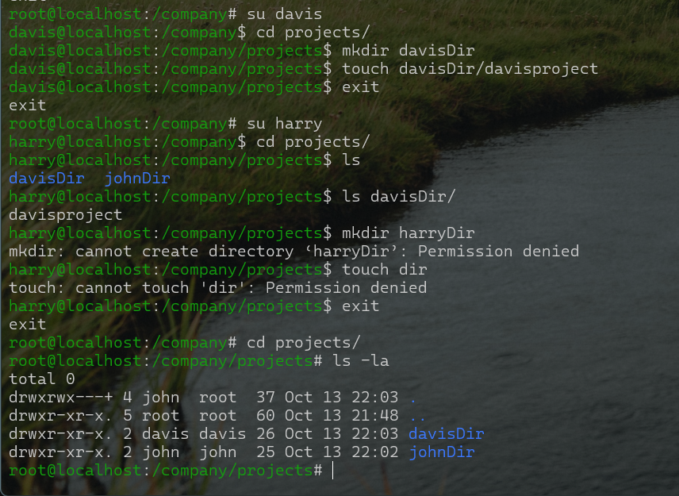

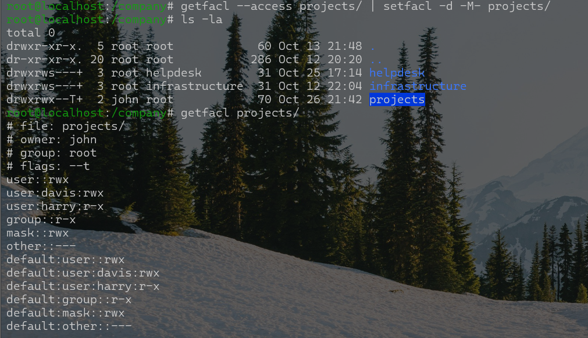

## 5. Restricted passwordless sudo for SSH

The Helpdesk user `harry` needed permission to restart `sshd` without gaining general root access. I initially encountered sudoers syntax errors and, during troubleshooting, temporarily added Harry to the `wheel` group. **I subsequently removed that membership** and corrected the sudoers entry to scope `NOPASSWD` to the one intended command.

Final rule documented in the lab:

```sudoers
harry ALL=(root) NOPASSWD: /usr/bin/systemctl restart sshd
```

I tested that `sudo systemctl restart sshd` worked while other attempted service-management commands were not authorized without additional privileges. I also tested persistence following a reboot. The complete effective sudo policy should be verified with `sudo -l -U harry` as an additional check, particularly in environments with multiple sudoers files.


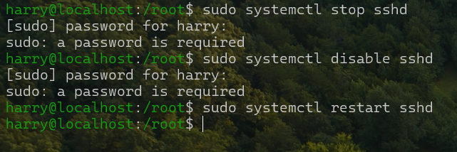

## 6. User-specific default permissions (umask)

The objective was to give Davis these defaults for newly created objects:

| Object | Expected permissions | Octal mode |
|---|---|---:|
| Regular file | `rw-r-----` | `640` |
| Directory | `rwxr-x---` | `750` |

My first attempt used `umask 0137`, which was incorrect. I recalculated the mask and configured `umask 0027` in Davis's `~/.bashrc`.

```bash
umask 0027
```

I verified the result in **Davis's home directory**, rather than inside `/company/projects`, to avoid mixing this test with the project directory's default ACLs. The screenshots show newly created files with mode `640` and directories with mode `750`.

**Scope note:** A `.bashrc` setting applies to Bash sessions that read that file; it is not a universal system-wide policy for all processes run as Davis.

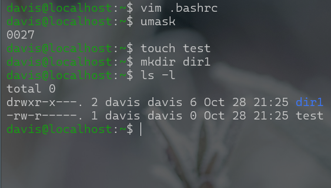

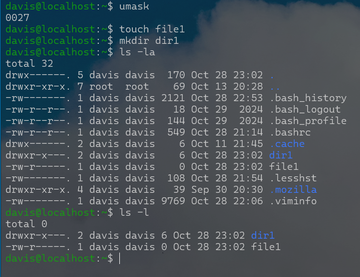

## 7. Troubleshooting a restrictive ACL mask

This was the most challenging part of the lab. I wanted Davis to have a named ACL entry granting `rwx` on a file, but for writing to fail due to the effective ACL mask.

I created `/company/projects/prod.txt` as John, then used `setfacl` to create and inspect the masking behavior. The key condition was:

```text
user:davis:rwx        #effective:r-x
mask::r-x
```

The named ACL grants `rwx`, but the mask limits Davis's **effective** permissions to `r-x`, so appending to the file fails. The `-n` option to `setfacl` prevents automatic ACL mask recalculation during the relevant modification.

I then adjusted the mask to restore writing and demonstrated that Davis could modify **`prod.txt`**. The file's ownership was not changed as part of this troubleshooting step.

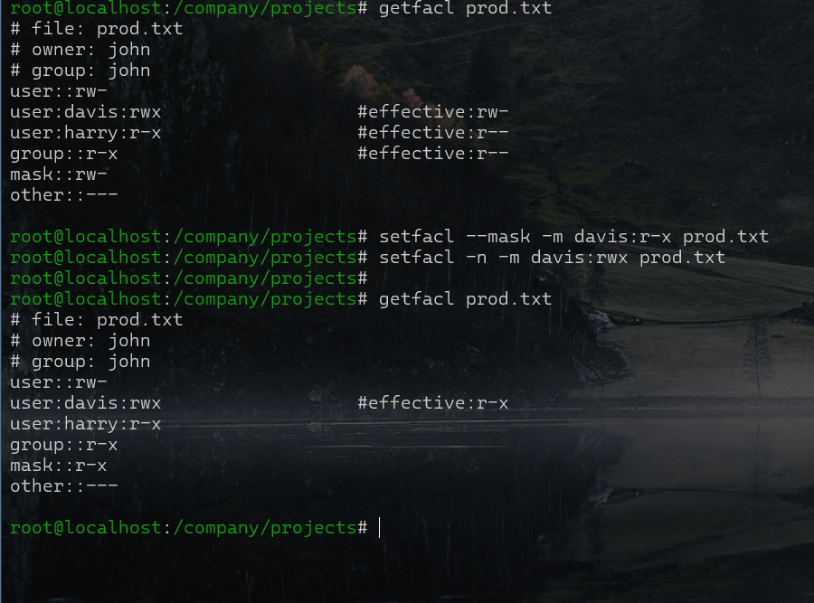

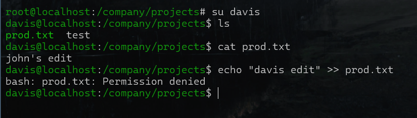

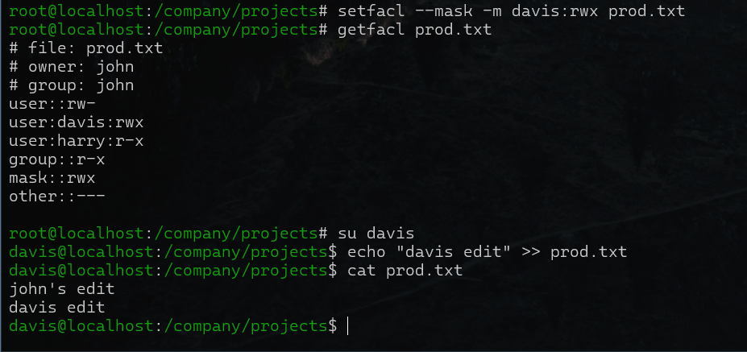

## 8. Verification after reboot

I rebooted the RHEL virtual machine and checked that the accounts, group definitions, ACLs, and sudo configuration remained present. I also tested access restrictions using an unrelated user account and checked Davis's file creation permissions.

| Check | Evidence in lab notes |
|---|---|
| Users and group membership | `/etc/passwd`, `/etc/group` and login checks |
| Password age / expiration | `passwd` and `chage` displays |
| Directory permissions | `ls -l`, `getfacl` and user tests |
| ACL inheritance | Default ACL inspection and test entries |
| Restricted sudo | Permitted restart, denied other attempted commands |
| User-specific umask | New file and directory in `/home/davis` |
| Unauthorized access | Unrelated user receives permission denied |

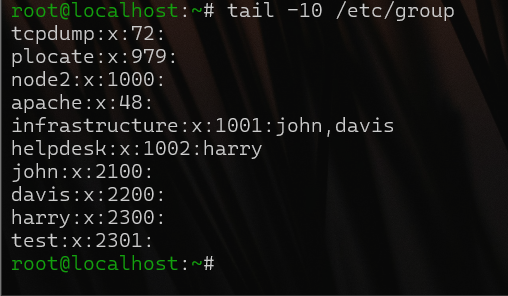

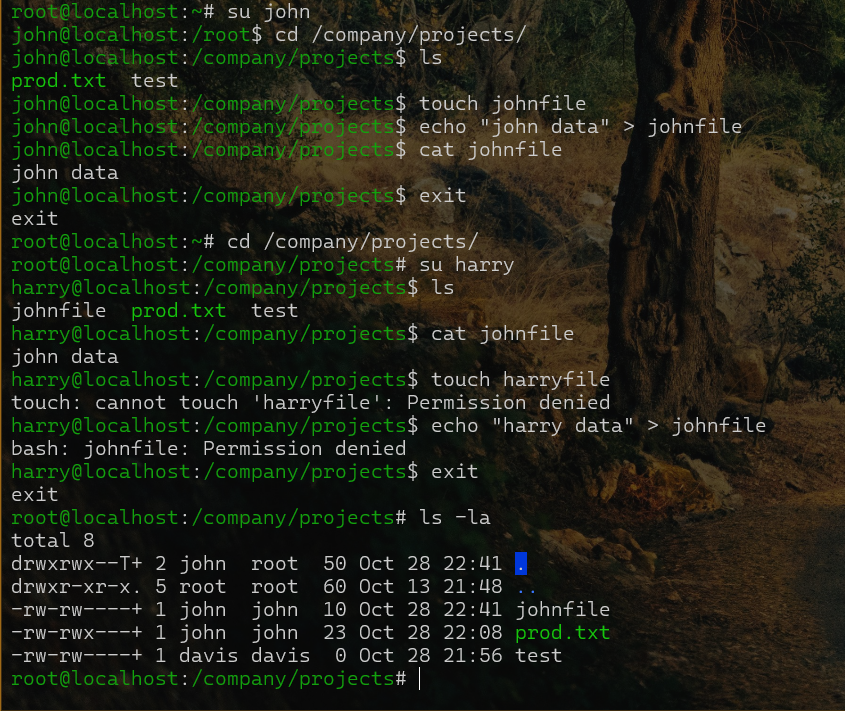

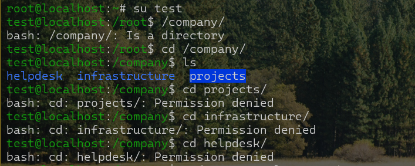

## Key takeaways

1. The **setgid directory bit** preserves group inheritance; it is distinct from the sticky bit and default ACLs.
2. A directory needs `x` permission for traversal; `r` alone is not enough.
3. **Access ACLs** set current permissions; **default ACLs** influence permissions inherited by newly created entries.
4. The ACL **mask** can restrict effective access even when a named entry says `rwx`.
5. Sudo access should be restricted to the exact command required, not granted through broad group membership.
6. `umask` should be tested outside directories with default ACLs when verifying a user's ordinary file creation defaults.

## Follow-up checks

- Investigate the account expiration date's one-day discrepancy rather than assume the observed workaround is portable.
- Test newly created descendants under `/company/helpdesk` to confirm the complete intended access policy is inherited.
- Optionally verify Harry's effective sudo privileges with `sudo -l -U harry` and verify `umask` behavior for session types beyond the Bash login tested here.

---

*Independent RHEL 10 administration practice for RHCSA preparation. These are lab accounts and simulated company directories.*
