# Configuring Apache with a Custom Document Root and Port (RHEL 10)

## Objective

Configure Apache HTTP Server (`httpd`) to serve a test page from `/webdata` on TCP port `8090`, while **keeping SELinux enforcing** and making the configuration persistent across reboots.

This is a personal, hands-on RHCSA preparation lab conducted in a RHEL 10 virtual machine. The notes below document the configuration, errors encountered, corrections, and test results.

## Lab environment

- **OS:** Red Hat Enterprise Linux 10
- **Virtualization:** VMware
- **Web server:** Apache HTTP Server (`httpd`)
- **DocumentRoot:** `/webdata`
- **HTTP port:** `8090/tcp`
- **Security:** SELinux and firewalld

## Configuration and troubleshooting

### 1. Install and configure Apache

Install the package (using root or `sudo` as appropriate):

```bash
dnf install httpd
```

Edit `/etc/httpd/conf/httpd.conf` and set the custom document root, corresponding directory configuration, and listener. The relevant settings were:

```apache
Listen 8090
DocumentRoot "/webdata"
<Directory "/webdata">
    # Other access directives depend on the existing Apache configuration.
    Require all granted
</Directory>
```

> The example above illustrates the relevant directives rather than reproducing the entire configuration file. The actual lab involved editing the existing `DocumentRoot` and `<Directory>` entries.

Create the directory and the test page before starting Apache:

```bash
mkdir -p /webdata
echo 'Hello from RHEL!' > /webdata/index.html
```

**Troubleshooting observation:** An early start attempt failed with an error equivalent to:

```text
AH00526: Syntax error on line 124 of /etc/httpd/conf/httpd.conf:
DocumentRoot '/webdata' is not a directory, or is not readable
```

The directory had not yet been created when Apache was first started. Later, the directory was created, trailing slashes were added to the configured paths, and Apache started successfully. **The initially missing directory is the most likely cause; a trailing `/` is not generally required for `DocumentRoot`.** These changes were made before a successful retest, so the exact cause was not isolated experimentally. The service messages were inspected with `systemctl status httpd` and `journalctl -xeu httpd`.

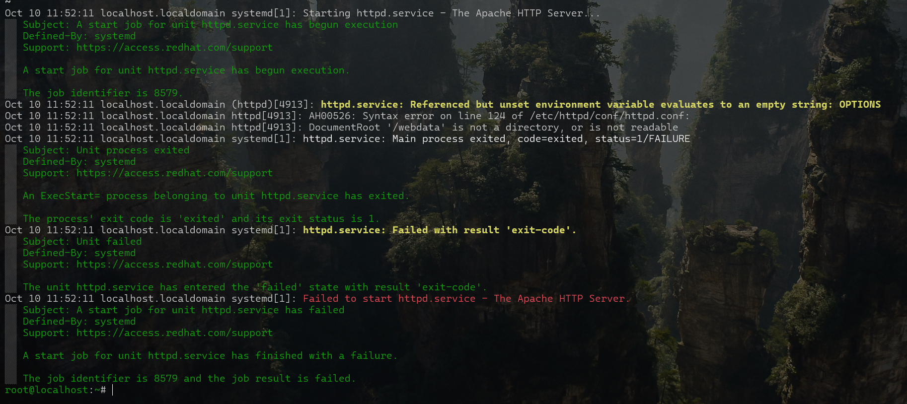

For future troubleshooting, check the directory itself and use `apachectl configtest` before restarting the service.

### 2. Configure persistent SELinux file labels

Inspect the default labels used for Apache content:

```bash
ls -lZ /var/www/
```

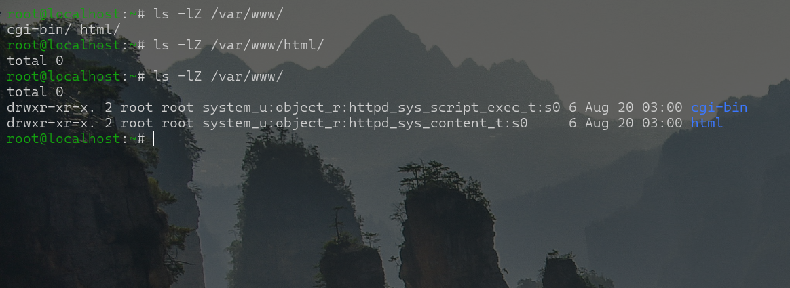

Assign an appropriate persistent file-context rule for `/webdata` and its contents, then apply the rule to the filesystem:

```bash
semanage fcontext -a -t httpd_sys_content_t '/webdata(/.*)?'
restorecon -Rv /webdata
```

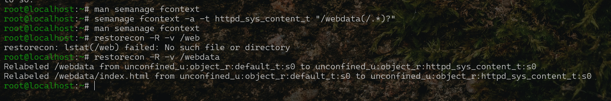

Verify the resulting labels:

```bash
ls -Zd /webdata
ls -Z /webdata/index.html
```

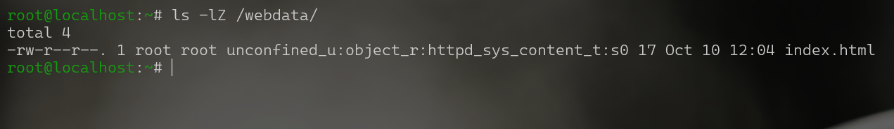

 `semanage fcontext` records a persistent mapping; `restorecon` applies the expected contexts. This is preferable to a one-off relabeling that can be lost when contexts are restored.

### 3. Configure the custom port for Apache in SELinux

Permit Apache's HTTP domain to bind to TCP port 8090, if it is not already assigned to the `http_port_t` type:

```bash
semanage port -l | grep http_port_t
semanage port -a -t http_port_t -p tcp 8090
```

If the port already has an assignment, adding it again will fail; inspect the existing configuration first rather than blindly repeating `-a`.

The lab's verification output showed `8090` listed under `http_port_t`:

```bash
semanage port -l | grep 8090
```

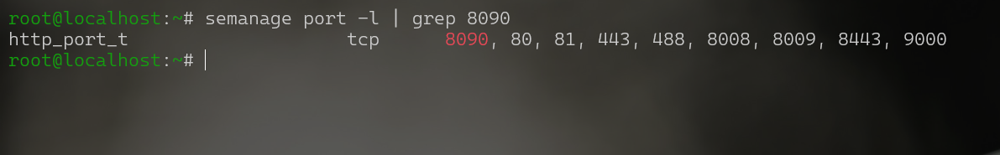

### 4. Configure firewalld

The lab configured a persistent firewall rule for the custom port and reloaded firewalld:

```bash
firewall-cmd --permanent --add-port=8090/tcp
firewall-cmd --reload
firewall-cmd --list-all
```

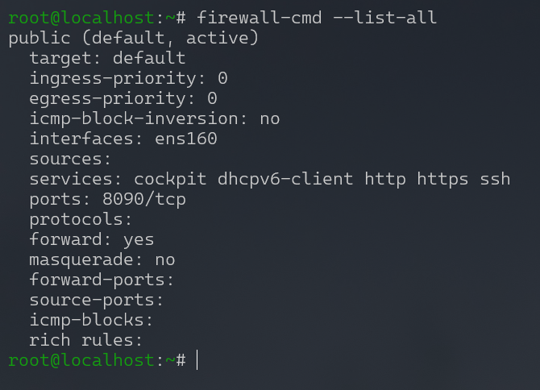

**Note:** `--add-service=http` was also used during practice, but it is unnecessary for this specific `8090/tcp` test. The standard `http` firewalld service ordinarily covers TCP port 80, not the custom port used here. The firewall rule matters for connections from other machines; a localhost `curl` alone does not test remote network accessibility.

### 5. Start, enable, and verify Apache

After correcting the configuration and SELinux settings, Apache was observed running successfully.

```bash
systemctl enable --now httpd
systemctl status httpd
curl http://localhost:8090
```

The local request returned:

```text
Hello from RHEL!
```

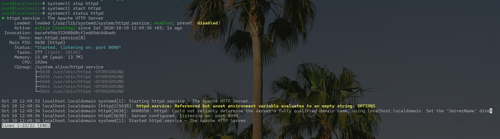
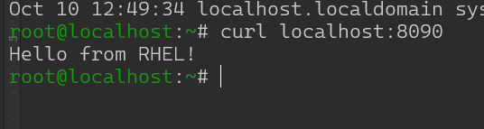

The lab also encountered a further unsuccessful service start during setup; the relevant error was preserved for troubleshooting rather than omitted:

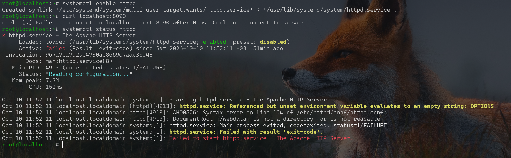

## Persistence and security verification after reboot

The VM was rebooted, an SSH session was re-established, and the same local HTTP request was repeated:

```bash
curl http://localhost:8090
```

It again returned:

```text
Hello from RHEL!
```

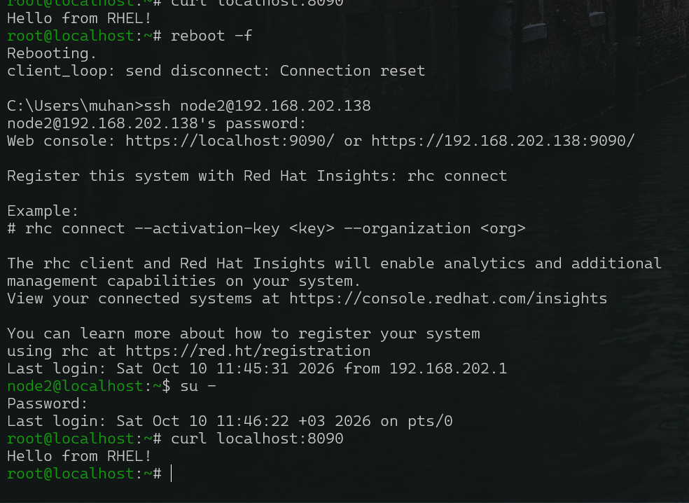

The following checks were also performed after reboot:

```bash
getenforce
# Enforcing
systemctl is-enabled httpd
# enabled
systemctl is-active httpd
# active
ls -Zd /webdata
# unconfined_u:object_r:httpd_sys_content_t:s0 /webdata
ls -Z /webdata/index.html
# unconfined_u:object_r:httpd_sys_content_t:s0 /webdata/index.html
```

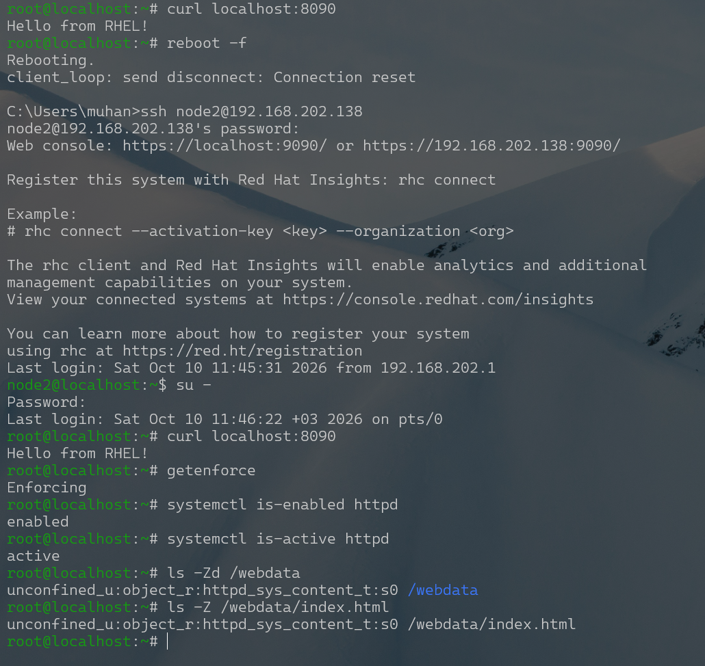

**Verified after reboot:** The test page was accessible, SELinux remained enforcing, the Apache service was enabled and active, and both the web root and its index page retained the `httpd_sys_content_t` file type. The earlier port-listing screenshot also confirms the custom port's `http_port_t` assignment; that command was not repeated in the post-reboot screenshot.

## Key takeaways

- Apache's custom document root must exist and be accessible before starting the service.
- SELinux file labels and SELinux port types address **different** access-control concerns.
- `semanage fcontext` combined with `restorecon` provides persistent content labeling.
- Opening `8090/tcp` in firewalld is separate from allowing Apache to bind to that port under SELinux.
- Reviewing service errors and retesting after a reboot helped validate the configuration.

## Lab scope

This exercise documents configuring a working Apache server with a custom document root and port, troubleshooting a startup problem, applying SELinux settings, and checking persistence.
