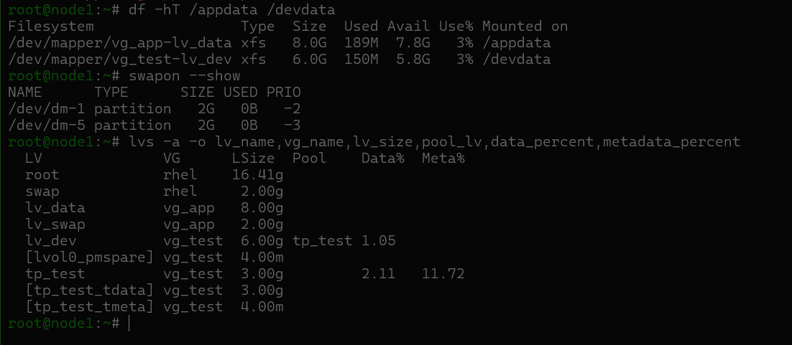

# Lab 03 — Linux Storage Management with LVM (RHEL 10)

> **Hands-on training lab** — Storage provisioning, XFS growth, volume-group expansion, swap, thin provisioning, persistent mounts, and troubleshooting in a RHEL 10 virtual machine. This is a personal learning exercise, not a production deployment guide.

## Objective

Configure additional virtual disks for application and testing workloads, grow storage online, keep mount and swap settings persistent, and investigate common LVM/filesystem problems.

## Environment and storage layout

- **Platform:** Red Hat Enterprise Linux 10 virtual machine
- **System disk:** `/dev/nvme0n1` (20 GiB; left intact)
- **Application disk:** `/dev/nvme0n2` (10 GiB; GPT with Linux LVM partition `/dev/nvme0n2p1`)
- **Expansion disk:** `/dev/nvme0n3` (5 GiB; added as a whole-disk physical volume)
- **Testing disk:** `/dev/nvme0n4` (5 GiB; separate VG for thin provisioning)

| Resource | Configuration | Purpose |
|---|---|---|
| `vg_app/lv_data` | 8 GiB, XFS, `/appdata` | Application filesystem (originally 6 GiB) |
| `vg_app/lv_swap` | 2 GiB swap | Additional active swap |
| `vg_test/tp_test` | 3 GiB thin pool | Physical allocation backing test volume |
| `vg_test/lv_dev` | 6 GiB virtual XFS, `/devdata` | Thin-provisioned development storage |

## 1. Disk discovery and partitioning

Identified all disks using `lsblk -p` and confirmed that `/dev/nvme0n1` contained the operating system. On the 10 GiB application disk, created a GPT table and one Linux LVM partition with `fdisk`, then verified the resulting `/dev/nvme0n2p1` device.

**Lessons:** Verify device identity before changing partition tables. The system disk was not modified.

## 2. Create the application volume

Created the physical volume, volume group, and initial logical volume:

```bash
pvcreate /dev/nvme0n2p1
vgcreate vg_app /dev/nvme0n2p1
lvcreate -L 6G -n lv_data vg_app
mkfs.xfs /dev/vg_app/lv_data
mkdir -p /appdata
```

Added an XFS mount entry for `/dev/vg_app/lv_data` in `/etc/fstab`, refreshed systemd's generated units, and mounted the filesystem. The LV path was used rather than a UUID for this entry; both are supported when correctly configured.

```fstab
/dev/vg_app/lv_data  /appdata  xfs  defaults  0 0
```

## 3. Expand XFS online

Increased `lv_data` from 6 to 8 GiB, then grew the mounted XFS filesystem:

```bash
lvextend -L +2G /dev/vg_app/lv_data
xfs_growfs /appdata
```

The actual filesystem growth was performed while mounted; the original notes show `xfs_growfs` invoked using the device path, which succeeded in the lab. Growth of the LV alone does not update XFS filesystem capacity. A pre-expansion data-integrity file was **not created**, so preservation of a specific existing file during this operation was **not independently tested**.

## 4. Add a second physical volume

Added the unpartitioned 5 GiB expansion disk directly to `vg_app`:

```bash
pvcreate /dev/nvme0n3
vgextend vg_app /dev/nvme0n3
```

The volume group grew from approximately 10 to 15 GiB without rebuilding `lv_data`. LVM supports using a whole disk as a PV; partitioning first was not necessary in this specific lab.

## 5. Add persistent swap

Created a separate 2 GiB swap LV without replacing the existing system swap:

```bash
lvcreate -L 2G -n lv_swap vg_app
mkswap /dev/vg_app/lv_swap
swapon -a
```

The corresponding persistent entry was added to `/etc/fstab` before `swapon -a`:

```fstab
/dev/vg_app/lv_swap  none  swap  defaults  0 0
```

Final verification shows **two active 2 GiB swap devices**, the original and the additional LV.

## 6. Thin provisioning

Created `vg_test` on the third disk, a 3 GiB thin pool, and a 6 GiB virtual logical volume:

```bash
pvcreate /dev/nvme0n4
vgcreate vg_test /dev/nvme0n4
lvcreate --type thin-pool -L 3G vg_test
lvrename vg_test lvol1 tp_test
lvcreate --thinpool tp_test -n lv_dev -V 6G vg_test
mkfs.xfs /dev/vg_test/lv_dev
```

The thin LV was mounted at `/devdata` and configured in `/etc/fstab` using its filesystem UUID. A 6 GiB *virtual* size does not imply 6 GiB has been allocated in the 3 GiB pool. Thin pools need monitoring: if data or metadata space is exhausted, writes may fail or be queued. Auto-extension is possible only when appropriately configured and when the VG has spare physical capacity; it was **not tested** in this exercise.

## 7. Troubleshooting exercises

### A. Mount available now, missing after reboot

Commented out the `/appdata` fstab entry, unmounted the filesystem, manually mounted it, and rebooted. It was then absent from the mount table, illustrating that a manual mount does not create persistent boot configuration. The entry was restored before final verification, after which `/appdata` mounted automatically.

### B. Logical volume enlarged, filesystem unchanged

Created a temporary 1 GiB XFS LV, mounted it, and extended its block-device size by 500 MiB. The filesystem still reported its old size until `xfs_growfs` was run. The issue is **unallocated space inside the enlarged block device**, not a need to reformat the added area as a separate filesystem. The temporary LV was used only for demonstration.

## 8. Verification after reboot

The original lab records show the VGs and LVs present, the swap and both application mounts available after reboot. An additional terminal capture supplied afterward confirms:

| Check | Verified result |
|---|---|
| `df -hT /appdata` | XFS, **8.0 GiB**, mounted `/appdata` |
| `df -hT /devdata` | XFS, **6.0 GiB**, mounted `/devdata` |
| `swapon --show` | Two active swap devices, **2 GiB each** |
| `lvs` — `vg_app/lv_data` | **8.00 GiB** |
| `lvs` — `vg_app/lv_swap` | **2.00 GiB** |
| `lvs` — `vg_test/tp_test` | **3.00 GiB**, data **2.11%**, metadata **11.72%** |
| `lvs` — `vg_test/lv_dev` | **6.00 GiB** virtual size, data **1.05%** |



The screenshot confirms the listed state, but a full boot-journal check was not provided; therefore the lab does not assert that the journal contains zero storage-related errors.

## Selected original lab screenshots

The `screenshots/` folder also includes the original command screenshots extracted from the lab notes, preserving the setup and troubleshooting evidence. They are retained as a reference archive; the post-reboot terminal capture above is the clearest compact verification artifact.

## Key takeaways

- LVM separates physical storage, volume groups, logical volumes, and filesystems.
- Expanding an LV and growing its XFS filesystem are distinct operations; XFS can grow online.
- Whole-disk PVs can be used in LVM, and additional disks can extend an existing VG.
- Persistent mounts and swap depend on correct boot-time configuration.
- Thin-provisioned virtual capacity can exceed immediately allocated pool storage, so usage must be monitored.
- Reproduce configuration failures safely and verify the corrected state after reboot.

**Scope note:** A pre-expansion file-integrity check and a complete boot-journal audit were not performed; neither is claimed as verified.
